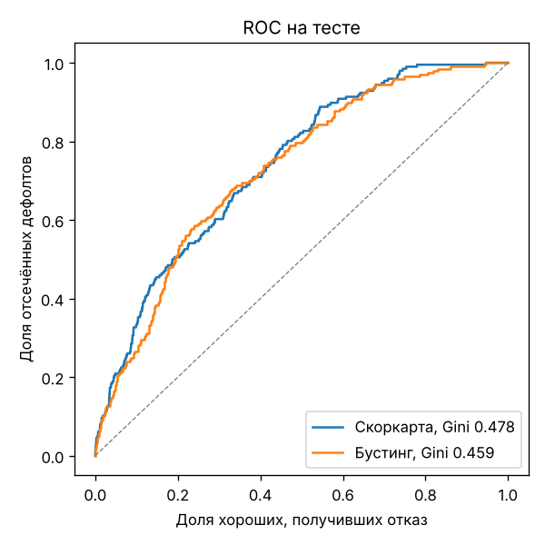
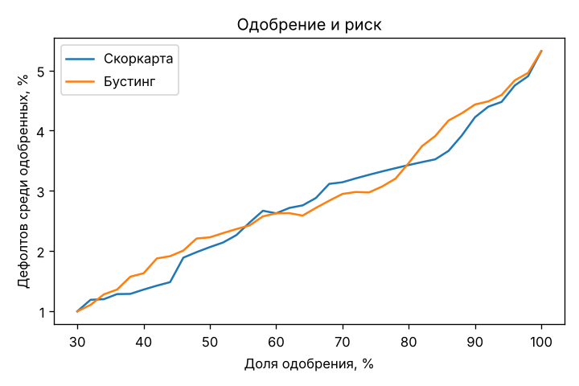

# Кредитный скоринг заявок (Application PD)

Модель оценивает вероятность того, что заёмщик допустит просрочку 90+ дней, по данным, известным
в момент подачи заявки. Результат - PD, скор в баллах, решение (одобрить / ручная проверка / отказ)
и причины низкого скора.

## Данные

`data/bank_credit_scoring.csv` - 18 420 выданных потребительских кредитов белорусского банка
(регионы Беларуси, скоринг оператора velcom). Источник датасета: _укажите ссылку_.

| Что есть | Колонки |
|---|---|
| Анкета | дата рождения, пол, образование, семейное положение, дети, отрасль, регион, населённый пункт |
| Заявка | лимит, срок, доход, показатель долговой нагрузки (ПДН) |
| Внешние данные | рейтинг кредитной истории (A1…E3), балл кредитного бюро, скоринг оператора связи |
| После выдачи | текущая задолженность, дни просрочки |

**Целевая переменная:** просрочка ≥ 90 дней, определение дефолта по Базелю. Таких кредитов 4,1%.
Задолженность и дни просрочки известны только после выдачи, поэтому в признаки они не попадают.

## Валидация по времени

Даты выдачи в данных нет, но её заменяет `CLIENTID`: номера выдаются по порядку, и у бо́льших номеров
меньше погашено долга. Поэтому:

- **разбиение по CLIENTID:** обучение на старых клиентах (60%), валидация (10%) и тест (20%) на более
  новых. Так модель проверяется в тех же условиях, в которых будет работать после внедрения;
- **самые новые 10% клиентов исключены:** их кредиты ещё не успели дойти до 90 дней просрочки, доля
  дефолтов там 1,8% против 5,3% на тесте. С ними целевая была бы искажена;
- все кредиты одного клиента попадают в одну часть.

Валидация используется для калибровки, выбора числа деревьев и проверки стабильности признаков.
Тест не участвует ни в одном решении.

## Модели

**Скоркарта (основная модель).** Стандарт розничного кредитования:

1. Биннинг признаков. В каждом бине не меньше 5% наблюдений, у числовых признаков WoE монотонен
   (без зигзагов, которые нельзя объяснить), редкие категории объединены.
2. Отбор: IV ≥ 0.02; из пары коррелирующих признаков (|r| > 0.7) остаётся более сильный. Все
   коэффициенты положительны: признак с отрицательным коэффициентом исключается, это симптом
   мультиколлинеарности.
3. Логистическая регрессия на WoE и Platt-калибровка на валидации. Калибровка - линейное преобразование
   логита, поэтому таблица баллов сохраняется.
4. Перевод в баллы: 600 баллов = шансы 50:1, +20 баллов удваивают шансы. Полная таблица -
   [`reports/scorecard.md`](reports/scorecard.md).

**Градиентный бустинг (претендент).** `HistGradientBoostingClassifier` - гистограммный бустинг, как
в LightGBM, с нативными категориями и пропусками. Монотонные ограничения заданы там, где направление
риска очевидно и подтверждено данными (доход, балл бюро, лимит/доход). Число деревьев подобрано по
log loss на валидации, затем Platt-калибровка.

**Исключённые признаки:**
- **пол** - защищённый признак, решение о кредите не должно от него зависеть;
- **ПДН** - PSI между обучением и валидацией 0.62, распределение сильно сдвинулось: максимум
  был 1.21, на новых клиентах - 0.51. Похоже на ограничение ПДН, введённое в кредитной политике. Риск
  у этого признака ещё и падает с ростом нагрузки - эффект отбора (высокую нагрузку одобряли только
  надёжным клиентам). Признак исключается автоматически по правилу PSI > 0.25 на валидации.

## Результаты на тесте

3 684 заявки, 196 дефолтов. Полный отчёт - [`reports/report.md`](reports/report.md).

| Модель | Gini [95% ДИ] | KS | Brier |
|---|---|---|---|
| Балл кредитного бюро (бейзлайн) | 0.235 [0.161-0.305] | 0.200 | - |
| **Скоркарта** | **0.478 [0.411-0.544]** | 0.344 | 0.0482 |
| Градиентный бустинг | 0.459 [0.388-0.523] | 0.349 | 0.0485 |

- Скоркарта вдвое сильнее балла бюро: собственные данные банка (доход, образование, отрасль, регион,
  скоринг оператора) добавляют много информации.
- Бустинг не лучше скоркарты (разница внутри доверительного интервала) и сильнее переобучается:
  Gini 0.78 на обучении против 0.46 на тесте, у скоркарты 0.60 против 0.48. При ~400 дефолтах
  в обучении сложной модели не на чем выигрывать, а скоркарта ещё и объяснима. Основная модель -
  скоркарта.
- С ПДН скоркарта давала 0.494 на тесте. 1,6 пункта Gini - цена устойчивости к смене политики.
- PSI скора между обучением и тестом 0.028 - стабилен. Калибровка близка к факту, кроме нижнего квинтиля
  (0,7% прогноз против 0,1% факта - модель там консервативна).

**Стратегия отсечения.** При одобрении 80% заявок доля дефолтов среди одобренных падает с 5,3% до 3,4%,
отсекается 48% дефолтов. Пороги в API выбраны по валидации: 70% заявок одобряются автоматически, 20%
уходят на ручную проверку, 10% - отказ.

<p>
  
  
</p>

## Запуск

```bash
pip install -r requirements.txt
python -m scoring.train                   # обучение и отчёт (~20 секунд)
uvicorn scoring.api:app --port 8000
curl -s localhost:8000/score -H 'Content-Type: application/json' -d @examples/application.json
```

```json
{"pd": 0.0309, "score": 587, "decision": "approve",
 "reasons": [{"feature": "telecom_status", "value": "not_requested", "points_lost": 38.4},
             {"feature": "industry", "value": "Торговля", "points_lost": 23.4},
             {"feature": "bureau_score", "value": "210", "points_lost": 22.5}]}
```

`reasons` - признаки, по которым заявка недобрала больше всего баллов до лучшего значения. Так формируются
причины отказа.

Через Docker (модель обучается при сборке):

```bash
docker build -t credit-scoring . && docker run -p 8000:8000 credit-scoring
```

Тесты: `pip install -r requirements-dev.txt && pytest`.

## Структура

```
scoring/
  data.py       загрузка, целевая, разбиение по времени
  features.py   признаки заявки (одни и те же для обучения и API)
  woe.py        биннинг и WoE
  scorecard.py  скоркарта: отбор, логрегрессия, калибровка, баллы, причины
  gbm.py        градиентный бустинг
  metrics.py    Gini, KS, PSI, бутстреп, таблица отсечения, калибровка
  train.py      обучение и отчёт
  service.py    скоринг заявок сохранённой моделью
  api.py        FastAPI
reports/        отчёт, таблица баллов, графики
examples/       пример заявки
tests/
```

## Ограничения

- **Reject inference.** В данных только одобренные заявки, поведение отказников неизвестно. Модель
  оценивает риск среди тех, кого банк и так одобрял бы. Отсюда и обратная зависимость риска от ПДН.
- **Нет дат.** Возраст считается на 01.01.2024, время восстановлено по CLIENTID. Если номера выдавались
  не строго по порядку, разбиение по времени приблизительное.
- **Мало дефолтов:** около 200 на тесте, интервалы Gini широкие (±0.07).
- **Пороги решения** выбраны по доле одобрения, а не по прибыли: для экономического порога нужны
  маржа и LGD, которых в данных нет.
